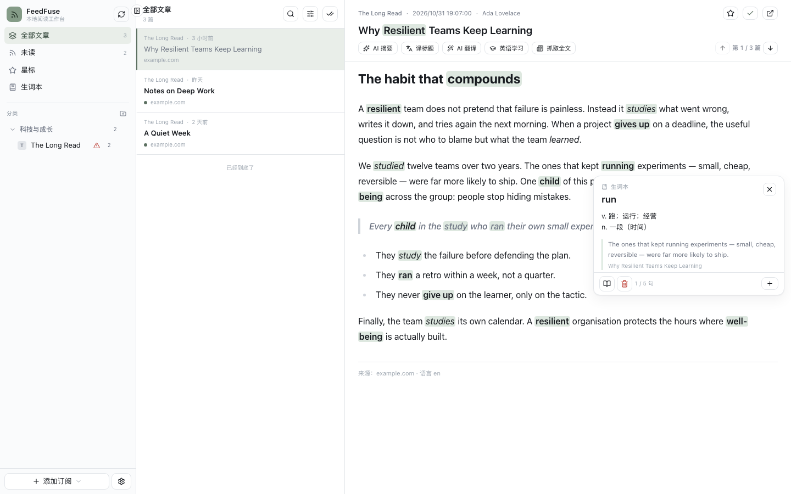
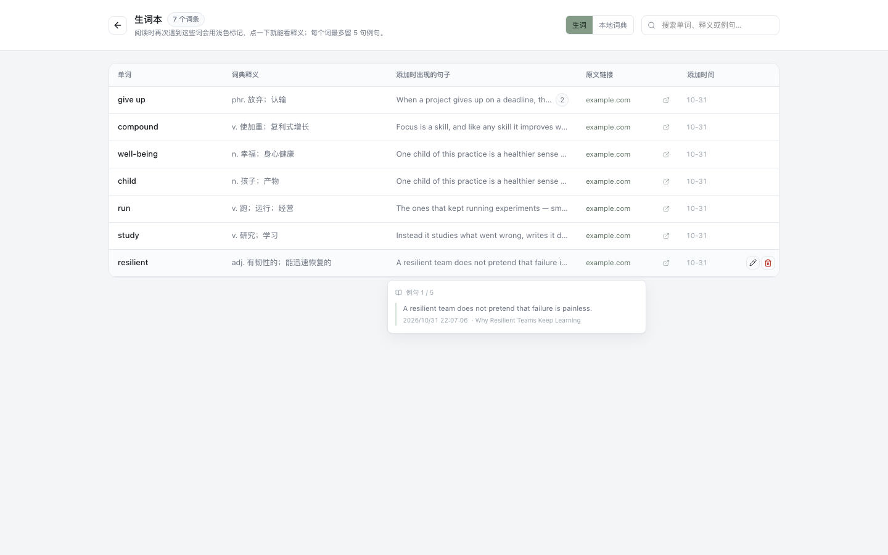
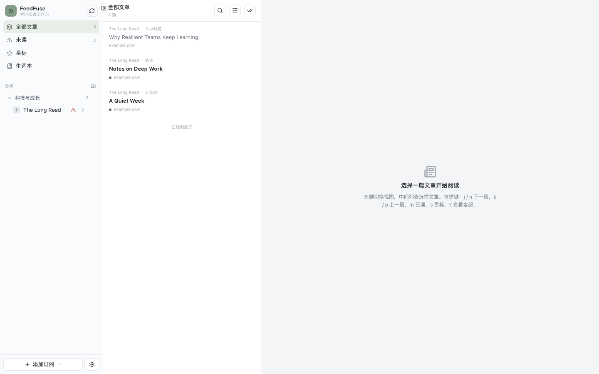
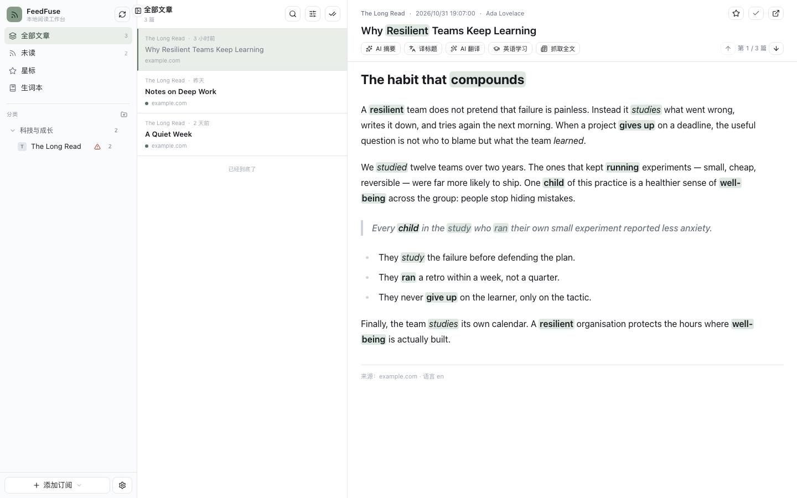

# FeedFuse Desktop

**一个为英语精读设计的桌面 RSS 阅读器。**

订阅你在读的英文源，然后在一处完成「读 → 查 → 记」：正文里认得出的生词已经标好底色，不认识的划一下就查，查完加入生词本、带上原句和出处。不需要 Docker，不需要 Postgres，不需要登录——下载、双击、开始读。

Tauri v2 外壳 + 本地 Node 服务 + 单文件 SQLite，数据全部躺在你自己的磁盘上。



---

## 为什么要有这个版本

[FeedFuse](https://github.com/BryanHoo/FeedFuse) 上游是一个自托管的 RSS + AI 阅读工作台，跑在 Next.js + Postgres + Docker 上，面向多用户部署。功能很全，但每次想读篇文章都得先起一个 compose 栈——这件事本身就劝退了。

这个仓库是它的**桌面重写**：Tauri v2 外壳拉起一个本地 Node 服务（Hono + `node:sqlite`），窗口导航到 `127.0.0.1` 的随机端口，单用户、单文件数据库。跟上游不共享代码，只沿用 OPML 格式和内置词典资源。

但换技术栈不是重点。真正想解决的是这件事：

> 用 RSS 读英文长文，读到一半总要切出去查词。查完回来忘了读到哪，记下的词下次还是不认得，认得的那批又每次都在眼前晃、分不清哪个才是新的。

所以这一版把绝大部分设计精力放在了**英语阅读体验**上。其余能力（订阅管理、过滤、全文抓取、搜索）保持够用就行。

---

## 英语阅读体验

### 一、读：生词在正文里就已经标出来了

收藏过的词会在标题和正文里加一层很淡的底色——取当前主题色再淡一档，不打断阅读节奏。点一下就地弹出释义浮层，可以删除，也可以把当前这句加进例句。

难的是**认得出变形**。生词本里存的是你收藏时那个形态（多半是原形），正文里出现的却往往是别的：

| 你收藏的 | 正文里能认出来的 |
| --- | --- |
| `study` | studies、studied、studying |
| `running` | run、runs、ran（反向还原成原形再展开） |
| `look forward to` | 词组整体匹配，被 `<b>` / `<a>` 切开也照常命中 |

做法是给每个词条生成一组**词形变体**再匹配：复数与三单（+s、+es、y→ies、f→ves，外加不规则复数表）、所有格（+'s、+'）、规则动词（+ed、y→ied、双写、+ing、去 e、ie→ying）、比较级与最高级（+er/+est，含双写与 y→i）。收藏的本身是变形时，先还原成原形再展开。

推导是保守的：只做规则加常见不规则，并且功能词不参与变形。否则收藏了 `us` 会让正文里所有 `uses` 都亮起来——那比不标还糟。完整逻辑在 `web/src/features/learning/vocabularyMatch.ts`。

标记只动文本节点，原 HTML 结构、链接、图片、行内样式全部保持原样；`pre`、`code`、按钮、译文区一律跳过。

### 二、查：划词，按粒度自动分流

打开阅读工具栏的「英语学习」后划词，程序先判断你选的是什么：

- **单词或短词组** → 先查本地词典，命中就直接出卡片
- **完整句子** → 交给模型结合上下文讲解这句在说什么
- **词组未收录** → 自动拆成逐词卡片，每个词单独查

三种卡片都支持「加入生词本」和「AI 详细解释」（SSE 流式回传，边生成边显示）。

选到半个词时会补全成整词——从段中间划出 `resilien` 也能查到 `resilient`。译文区、代码块、按钮不参与选区，避免选中不该选的东西。

### 三、记：生词本带着原句和出处

每个词条存的不只是单词和释义，还有它出现的那篇文章：标题、URL，以及最多 **5 句**例句——超出时丢最早的一句，保证例句池始终是你最近的上下文。

整页视图可以按单词、释义、例句搜索，也可以就地改释义。释义默认只显示核心义项，悬停才展开全部。



### 四、译：双语对照，而不是整篇替换

标题可以单独翻译；正文走**分批流式**的双语翻译，原文在上、译文在下，随时能对照回原文。译文区不参与划词和生词标记，不会污染阅读区。

翻译和摘要是两条独立的 AI 链路，可以共用同一个服务，也可以用不同的 Key 分开跑。

### 词典是离线的

内置约 **2.9 万条**核心英汉词库（考试大纲词汇与高频词，2.7MB JSON），随应用分发，断网也能查。

要更大覆盖就导入自己的：支持 **StarDict** 和 **MDict** 格式，导入后建 FTS 索引，并**优先于内置词库命中**——你导入的那本说了算。多个词典可以分别启用/停用，也可以随时删掉。

---

## 剩下的仍然是一个完整的 RSS 阅读器

英语体验是重点，但日常该有的都在：

- **订阅管理**：添加时校验源可用性，支持分类（新建、重命名、删除、拖拽排序）、单源或全部刷新、单源独立抓取间隔、失败状态与错误原因记录
- **RSS 目录**：内置 3700+ 中英文来源，按主题、语言、关键词筛选。入口收在「添加订阅 → 从 RSS 目录挑选」二级菜单
- **阅读**：三栏布局、未读/星标/全部视图、打开自动标记已读（可配延迟）、按源或分类过滤、分页游标
- **搜索**：SQLite FTS5 全文索引（标题 + 摘要 + 正文）
- **全文抓取**：Readability 提取正文，可选「打开时抓取」或「抓取订阅时抓取」
- **AI 摘要**：流式输出，生成进度落库，刷新页面仍然在
- **文章过滤**：三层减噪——关键词过滤、AI 语义过滤（按自定义提示词判定）、重复转载去重（归一化 URL + 归一化标题 + SimHash 指纹）。命中即标记为已过滤并记原因；改完规则会自动重判历史文章
- **按源触发策略**：入库抓全文 / 打开抓全文、打开生成摘要、译标题、译正文，逐订阅独立配置
- **图片代理**：正文图片统一走本地 `/api/image?u=…&s=签名`，绕开防盗链，也避免 WebView 直连第三方
- **主题色**：苔绿 `#849B87`、雾紫 `#A095B8`、藕粉 `#BC929D`、雾蓝 `#8199B1`，外加黑白方案。它只决定强调色（按钮、选中态、链接、图标圆点），底色与正文保持中性；和浅色/深色是两个独立选项，任意组合都成立
- **OPML 导入/导出**：设置 → 订阅 → 订阅清单（OPML）
- **系统日志**：本地落库，按级别查看与清理，按保留天数自动裁剪





### 相比上游去掉了什么

| 去掉的能力 | 原因 |
| --- | --- |
| 多用户 / 登录 / 权限 | 桌面版本地单机，一个安装一份数据。引入账号只会带来登录页、会话、权限校验，数据库里也不再有任何 `user_id` 维度 |
| Fever 外部账号同步 | 依赖第三方账号与凭据，属于联网服务而非本地阅读器；对方停服就不可用 |
| AI 解读（多源汇总） | 要跨订阅汇总一批文章再喂模型，成本和延迟都高，与「单篇阅读」主链路耦合弱；单篇摘要、翻译、精讲已覆盖绝大多数场景 |

---

## 架构

```
┌──────────────────────────── Tauri 窗口（WebView） ────────────────────────────┐
│  http://127.0.0.1:<随机端口>/          ← 同源：页面和 API 同一个 origin         │
│      ├── GET /                 Vite 产出的 dist/index.html（由 sidecar 静态托管）│
│      └── GET /api/*            fetch + x-feedfuse-token                        │
└───────────────────────────────────┬───────────────────────────────────────────┘
                                    │ 本机回环，不出网卡
┌───────────────────────────────────▼───────────────────────────────────────────┐
│  Node sidecar（Tauri 用 std::process::Command 拉起）                            │
│    server/dist/server.mjs  +  server/node_modules（生产依赖）                   │
│    Hono 路由 /api/*  →  domain 函数  →  node:sqlite                             │
│    services/：rss 抓取 · fulltext(Readability) · ai(SSE) · imageProxy(签名)      │
│               filters(关键词/AI/查重) · translate · opener(系统浏览器)           │
└───────────────────────────────────┬───────────────────────────────────────────┘
                                    │
                        ~/Library/Application Support/com.feedfuse.desktop/
                          └── feedfuse.db (WAL)  ← 单文件，删了就是重置
```

启动时序：

```
Tauri 进程启动
  └─ 生成一次性 token、解析 node / server.mjs / web 目录
      └─ spawn node server.mjs（FEEDFUSE_PORT=0 让系统分配端口）
          └─ stdout 打印：[feedfuse-ready] {"port":…,"token":"…","baseUrl":"…"}
              └─ 外壳收到握手行 → window.navigate(baseUrl) → 显示窗口
```

| 目录 | 内容 | 产物 |
| --- | --- | --- |
| `web/` | Vite + React 19 + Tailwind 4 单页应用 | `web/dist/` |
| `server/` | Node + Hono + `node:sqlite` 本地后端 | `server/dist/server.mjs` + `dist/schema.sql` |
| `src-tauri/` | Tauri v2 外壳，拉起 sidecar 并导航窗口 | `.app` / `.exe` / `.deb` |
| `scripts/` | 打包编排与本地开发脚本 | — |

第三方依赖**不打包进 `server.mjs`**（`packages: 'external'`），而是随包带一份生产 `node_modules`，运行时由 Node 从 `server/node_modules` 解析。`scripts/stage-sidecar.mjs` 负责把它们摊到 `src-tauri/resources/`。

细节见 [docs/ARCHITECTURE.md](docs/ARCHITECTURE.md)，日常开发约定见 [docs/DEVELOPMENT.md](docs/DEVELOPMENT.md)。

---

## 开发

环境要求：Node **>= 22.5**（用到内置的 `node:sqlite`）、pnpm 10（`packageManager` 锁在 `pnpm@10.30.3`）。只有打包才需要 Rust 工具链和 Tauri 的系统依赖。

```bash
pnpm install
node scripts/dev-local.mjs        # 同时起后端(9559)和前端(5173)，日志带前缀，Ctrl-C 一起退
# 打开 http://localhost:5173
```

等价的分离跑法：

```bash
# 终端 A：后端
FEEDFUSE_PORT=9559 FEEDFUSE_ALLOW_ANON=1 FEEDFUSE_DATA_DIR=.dev-data pnpm dev:server
# 终端 B：前端（/api 代理到 127.0.0.1:9559）
pnpm dev:web
```

> Vite 的代理目标写死 `127.0.0.1:9559`，所以分开跑时**必须**给后端指定 `FEEDFUSE_PORT=9559`，否则后端用随机端口，前端代理 502。
> `FEEDFUSE_ALLOW_ANON=1` 跳过令牌校验，**仅限本机开发**。

只跑后端（纯 API 模式）：

```bash
pnpm build:server
FEEDFUSE_ALLOW_ANON=1 FEEDFUSE_DATA_DIR=.dev-data node server/dist/server.mjs
curl --noproxy '*' http://127.0.0.1:<握手行里的 port>/api/health
```

## 打包

```bash
pnpm install
pnpm tauri:build        # = build → fetch-node → stage → tauri build
```

分步排查时：

```bash
pnpm build                      # build:server + build:web
node scripts/stage-sidecar.mjs  # 把运行时摊到 src-tauri/resources
pnpm fetch-node                 # 下载 Node 运行时到 src-tauri/binaries/node-<triple>
pnpm tauri:build
```

产物在 `src-tauri/target/release/bundle/`：macOS 是 `.app` / `.dmg`，Windows 是 `.exe` / `.msi`，Linux 是 `.deb` / `.AppImage`。

⚠️ 打包前**必须先 stage**：`tauri.conf.json` 的 `bundle.resources` 只收 `resources/**/*`，不 stage 会打出一个没有后端代码的空壳。

## 数据在哪

由 `src-tauri/src/sidecar.rs` 的 `app_data_dir()` 决定，通过 `FEEDFUSE_DATA_DIR` 传给 sidecar，库名固定 `feedfuse.db`。

| 平台 | 位置 |
| --- | --- |
| macOS | `~/Library/Application Support/com.feedfuse.desktop/feedfuse.db` |
| Windows | `%APPDATA%\com.feedfuse.desktop\feedfuse.db` |
| Linux | `~/.local/share/com.feedfuse.desktop/feedfuse.db`（遵循 `$XDG_DATA_HOME`） |

同目录还有 `-wal` / `-shm`，备份或删除时要一起处理。开发态用仓库内的 `.dev-data/feedfuse.db`，不会碰到正式数据。

想搬走数据（U 盘、测试隔离）就覆盖 `FEEDFUSE_DATA_DIR`：

```bash
FEEDFUSE_DATA_DIR=/Volumes/USB/FeedFuse /Applications/FeedFuse.app/Contents/MacOS/FeedFuse
```

**重置全部数据**：退出应用，删掉数据目录里的 `feedfuse.db*`，下次启动自动重建表。只清日志去「日志」页点清空。

## 从上游迁移

库结构完全不同，数据不能直接搬，只需要搬**订阅清单**：

1. 上游：设置 → OPML 导出，得到 `*.opml`
2. 这边：设置 → 订阅 → 导入 OPML

导入会自动创建缺失的分类并后台刷新订阅。需要重新填的是 AI Key、自定义提示词，以及其他个性化项（主题、字号、抓取间隔、过滤器）。

---

## 常见问题

**AI 报 401 / 403** — Key 无效或没有该模型权限。检查摘要用的 Key 与模型是否匹配；翻译若没勾「复用同一个 AI 服务」，它会单独用翻译 Key。

**AI 报 404** — Base URL 不对。程序请求 `${Base URL}/chat/completions`，所以 Base URL 必须带 `/v1`，例如 `https://api.openai.com/v1`，不要写到 `/chat/completions`。

**AI 超时 / 429** — 超时上限：摘要 180s、翻译 120s、精讲 90s。429 是额度或频率限制，换 Key 或稍后再试；也可以用兼容 OpenAI 协议的自建网关。

**订阅抓取失败** — 先看侧边栏该源的错误提示，或「日志」里 `category = rss/ingest` 的记录。macOS 自动跟随系统 HTTP/HTTPS 代理（含 Clash/Surge 的系统代理），RSS、正文、图片、AI 共用；终端显式设置的 `HTTP_PROXY` / `HTTPS_PROXY` / `NO_PROXY` 优先，回环地址直连。纯 SOCKS/PAC 暂未接入。403、登录墙和必须执行 JavaScript 的站点仍可能提取不到。源地址要填 RSS/Atom 的 XML 地址而不是网站首页（添加时「校验」会直接报错）。返回 304 是正常的，说明 ETag/Last-Modified 命中、没有新文章。

**页面白屏 / 提示本地服务启动失败** — 窗口会显示原因。常见于：漏了 `node scripts/stage-sidecar.mjs`（找不到 `server.mjs`）、漏了 `pnpm fetch-node`（找不到 node 可执行文件）、或 120 秒内没等到握手行。终端里 `[feedfuse]` / `[sidecar]` 前缀的日志可直接定位。

**接口 401** — 本地令牌不匹配。应用内不会遇到；手动 curl 时要带 `x-feedfuse-token`，或用 `FEEDFUSE_ALLOW_ANON=1` 启动（仅开发）。本机有 `HTTP(S)_PROXY` 时 curl 记得加 `--noproxy '*'`。

启动时窗口是隐藏的，外壳拉起 sidecar 后会等它打印一行 `[feedfuse-ready] {...}`。5 秒没就绪先显示「正在启动本地服务…」，**不会**判定失败；总预算 120 秒（首次启动要过 Gatekeeper 校验 100MB+ 的 node，实测可能 20 秒以上）。只有「子进程提前退出」或「超过 120 秒」才显示失败页。

---

## 与上游的关系

这个仓库基于 [BryanHoo/FeedFuse](https://github.com/BryanHoo/FeedFuse) 的设计与词典资源，但已经是**独立分支**：不跟踪上游 `main`，不再合并上游提交，git 历史从桌面版第一版重新开始。

上游的新功能不会自动进来。值得移植的东西由维护者手工 port——两边的数据层（Postgres / 多用户 vs SQLite / 单用户）和 API 层已经完全分道扬镳，能对齐的只有前端交互和 UI 修复。

订阅抓取、过滤策略、AI 链路的设计思路大量来自原项目，内置词典文件也源自上游的 `public/dictionaries/en-zh.json`。

## License

见 [LICENSE](LICENSE)。
